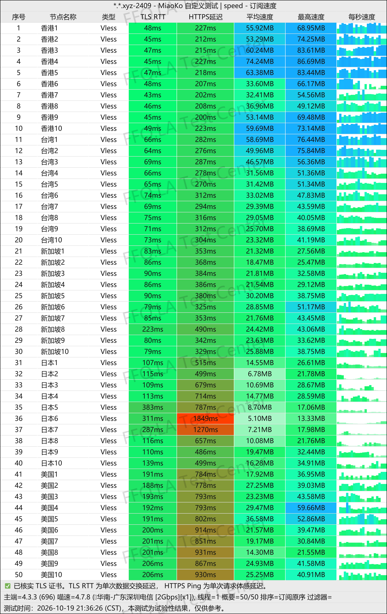
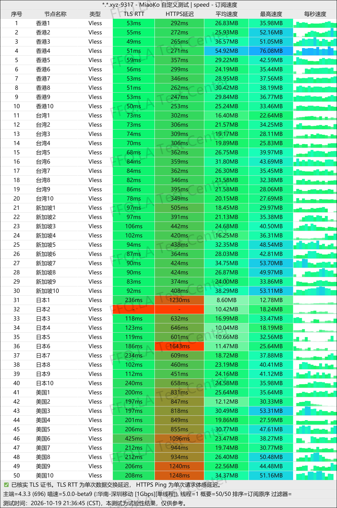
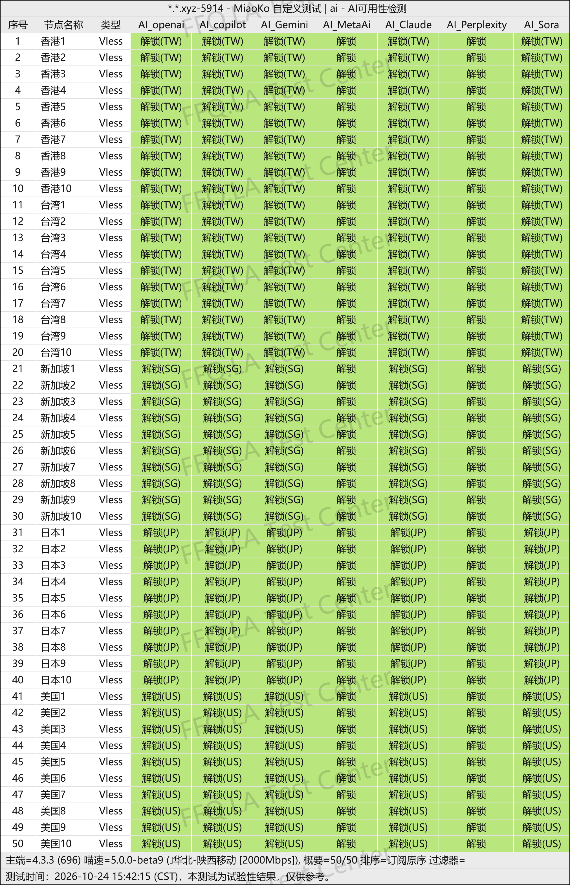
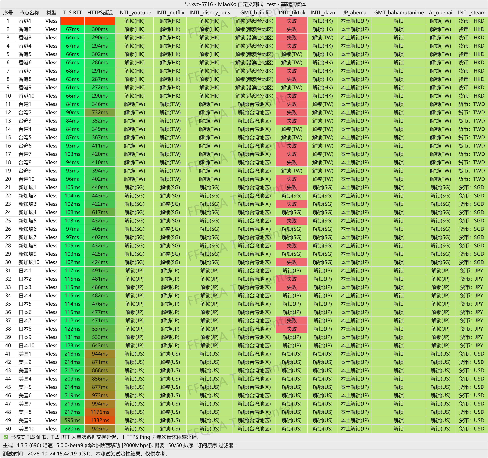
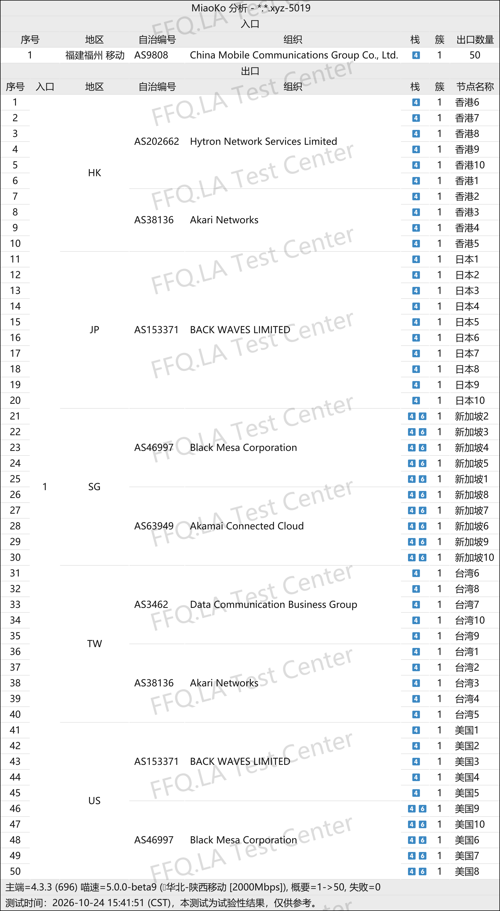

🇨🇳 [中文](README.md) | 🇺🇸 English | 🇷🇺 [Русский](README_RU.md) | 🇮🇷 [فارسی](README_FA.md)

# OKyun (OK Cloud) VPN Official Website (Updated November 4, 2026)

OKyun (OK Cloud) VPN Official Website<br>
`Existing PyroCloud users can log in directly.`<br>

Latest Address 01: [www.okyun1.com](https://to.iix.im/ok01)<br>
Latest Address 02: [www.okyun2.com](https://to.iix.im/ok02)<br>
Official Address: [www.ok云.com](https://to.iix.im/ok03)<br>

`Using the dedicated client application is strongly recommended. The official client uses dedicated network lines, while subscription-based connections use direct routes. Subscription connections are mainly suitable for China Mobile and China Unicom users. China Telecom users may experience reduced performance during evening peak hours because these routes have not been specifically optimized for China Telecom.`

Latest Recommended VPN Services and Node Sharing for 2026: [https://github.com/jdnei/JiChangTuiJian](https://github.com/jdnei/JiChangTuiJian)<br>

## Telegram VPN Deals & Benefits Community #AD

[VPN Giveaway Group](https://331024.de/archives/choujiang) | [VPN Chat Group](https://331024.de/archives/choujiang) | [VPN Trial Group](https://331024.de/archives/choujiang)<br>

[https://331024.de/archives/choujiang](https://331024.de/archives/choujiang)

## Invitation Code

```bash
JcL9ru2a
```

## Promo Code / Discount Code

`20% off, valid until the end of the day`

```bash
20261111
```

## Overview

OKyun (OK Cloud) VPN is a network acceleration service specializing in high-speed public internet relays and overseas transit connections.

The service uses the VLESS protocol and provides entry points through China's three major network operators, along with overseas relay servers.

OKyun supports Windows, macOS, Linux, Android, and iOS, and offers dedicated client applications.

It is suitable for everyday internet browsing, high-definition video streaming, AI tools, and international remote work.

## Advantages

OKyun uses a network architecture combining multiple domestic carrier entry points with overseas relay connections.

All servers use a **1× traffic multiplier**, helping users balance connection speed and efficient data usage.

The service supports access to Netflix, Disney+, ChatGPT, Claude, Gemini, and other popular international platforms.

It also provides proprietary client applications, intelligent traffic routing, and customizable proxy settings.

According to third-party speed tests, the service performs relatively well during evening peak hours.

OKyun combines beginner-friendly operation with flexible configuration options for more advanced users.

## Plans & Pricing

| Plan | Data Allowance | Monthly Price | Quarterly Price | Semiannual Price | Data Reset Fee | Network Routes / Server Locations | Features / Notes |
|---|---|---|---|---|---|---|---|
| Basic-50G | 50GB | ¥10 | ¥30 | ¥60 | ¥8 | Low-latency dedicated lines; Hong Kong, Taiwan, Singapore, Japan, United States | All servers support AI services and streaming platform unblocking |
| Advance-120G | 120GB | ¥20 | ¥60 | ¥120 | ¥16 | Low-latency dedicated lines; Hong Kong, Taiwan, Singapore, Japan, United States | All servers support AI services and streaming platform unblocking |
| Premium-280G | 280GB | ¥40 | ¥120 | ¥240 | ¥32 | Low-latency dedicated lines; Hong Kong, Taiwan, Singapore, Japan, United States | All servers support AI services and streaming platform unblocking |
| Ultimate-800G | 800GB | ¥100 | ¥300 | ¥600 | ¥80 | Low-latency dedicated lines; Hong Kong, Taiwan, Singapore, Japan, United States | All servers support AI services and streaming platform unblocking |

## 📊 Real-World Performance Tests & Analysis

#### 1.1 China Telecom Evening Peak-Hour Speed Test

<br>

#### 1.2 China Mobile Evening Peak-Hour Speed Test

<br>

#### 2.1 AI Service Unblocking Report

<br>

#### 2.2 Streaming Service Unblocking Report

<br>

#### 3. Exit Node and Network Entry Analysis

<br>
