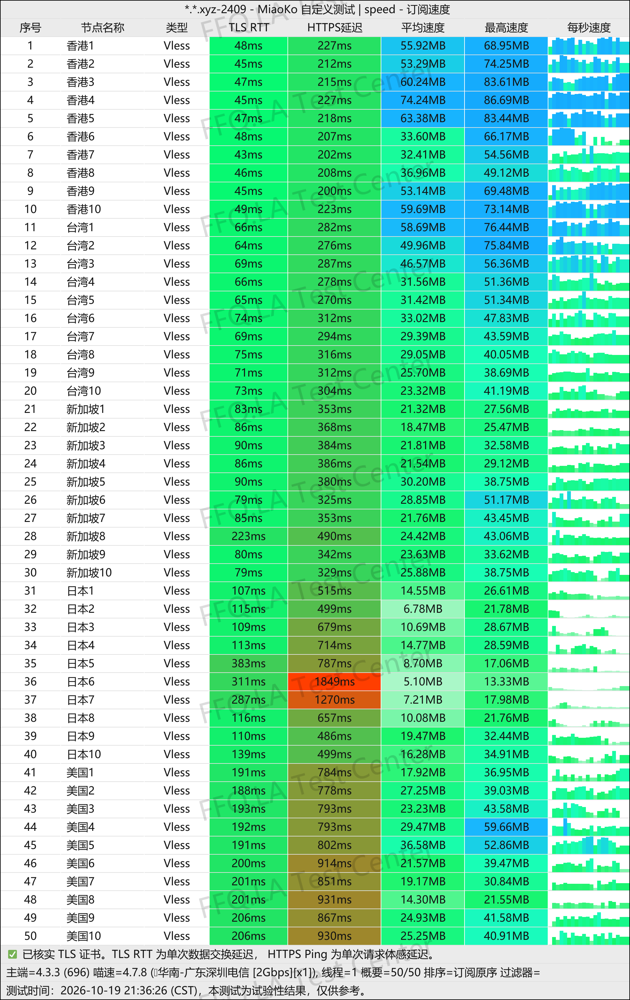
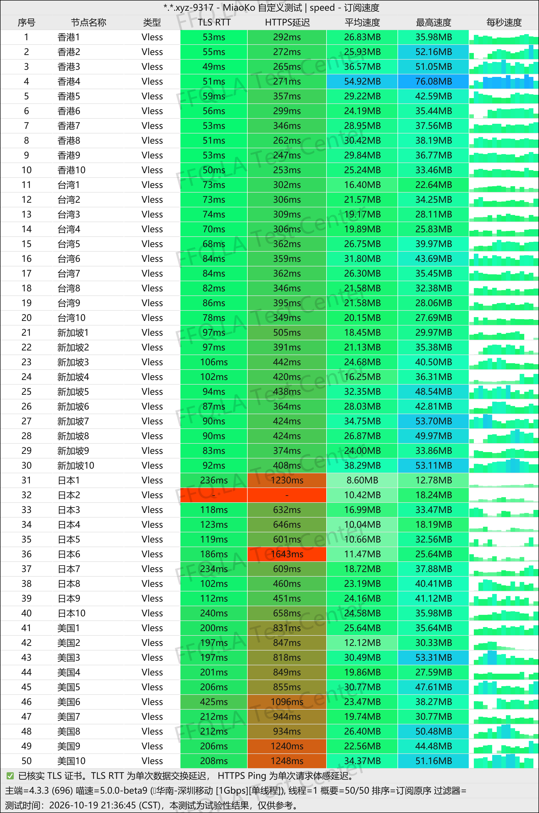
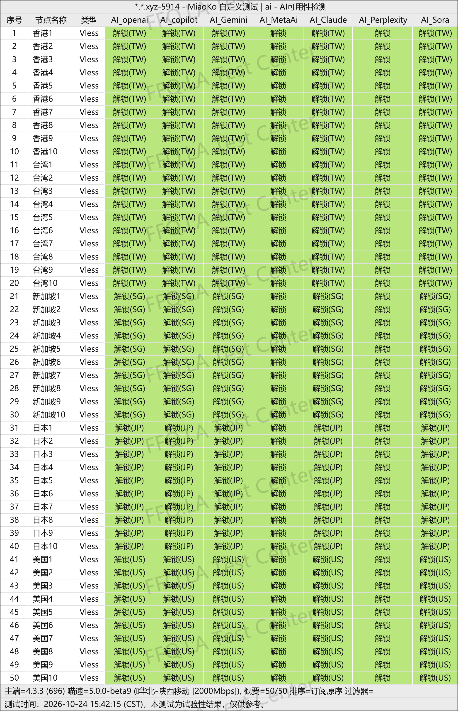
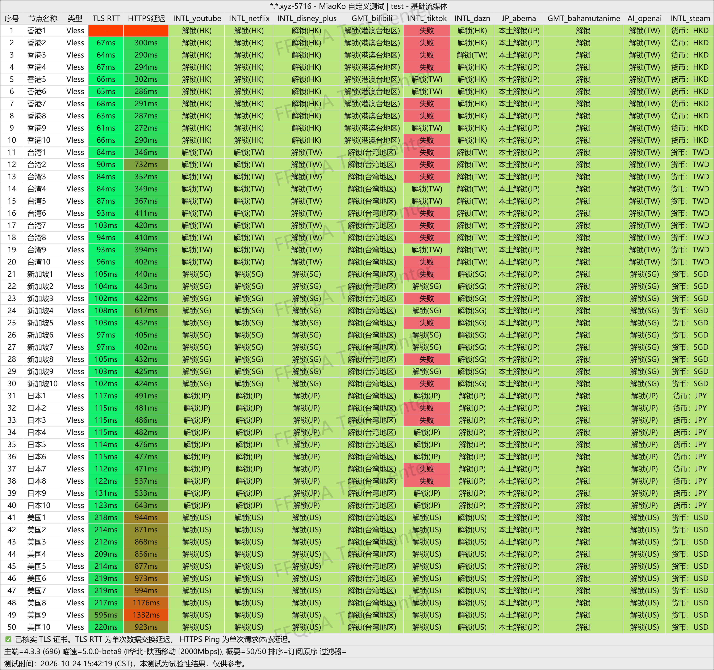
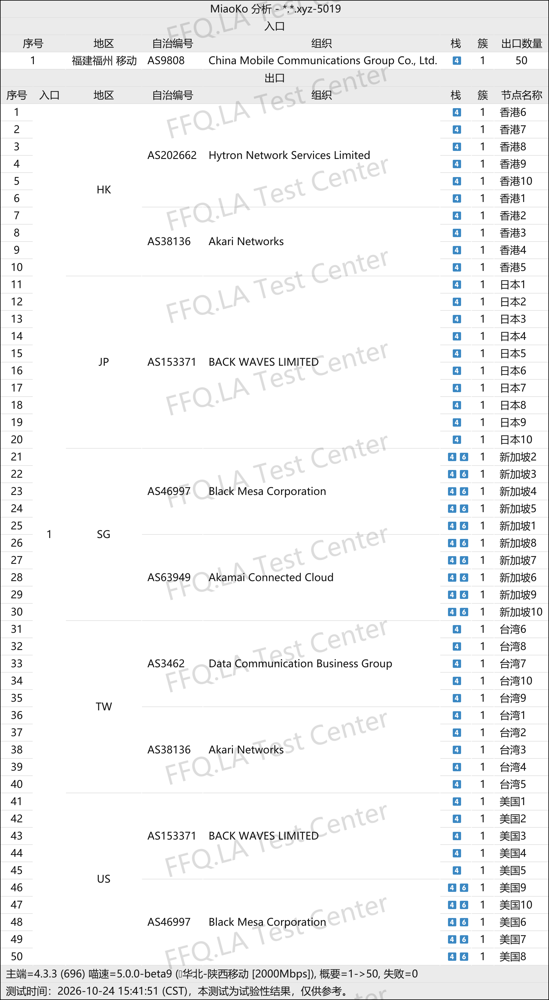

 🇨🇳 [中文](README.md) | 🇺🇸 [English](README_EN.md) | 🇷🇺 [Русский](README_RU.md) | 🇮🇷 فارسی
# آدرس رسمی VPN اوکی‌یون (OKyun / OK Cloud) -(به‌روزرسانی 12 نوامبر 2026)
وب‌سایت رسمی VPN اوکی‌یون (OKyun / OK Cloud)<br>
`کاربران قدیمی PyroCloud می‌توانند مستقیماً وارد حساب خود شوند.`<br>

جدیدترین آدرس ۰۱: [www.okyun1.com](https://to.iix.im/ok01)<br>
جدیدترین آدرس ۰۲: [www.okyun2.com](https://to.iix.im/ok02)<br>
آدرس رسمی: [www.ok云.com](https://to.iix.im/ok03)<br>

`توصیه می‌شود تا حد امکان از اپلیکیشن اختصاصی استفاده کنید. اپلیکیشن رسمی از خطوط ارتباطی اختصاصی استفاده می‌کند، در حالی که اتصال از طریق لینک اشتراک بر پایه مسیرهای مستقیم است. اتصال اشتراکی عمدتاً برای کاربران China Mobile و China Unicom مناسب است. کاربران China Telecom ممکن است در ساعات اوج مصرف شبانه عملکرد ضعیف‌تری تجربه کنند، زیرا این مسیرها به‌طور ویژه برای شبکه China Telecom بهینه‌سازی نشده‌اند.`

معرفی بهترین سرویس‌های VPN و اشتراک‌گذاری سرورها در سال ۲۰۲۶: [https://github.com/jdnei/JiChangTuiJian](https://github.com/jdnei/JiChangTuiJian)<br>

## انجمن تلگرامی تخفیف‌ها و مزایای VPN #AD

[گروه قرعه‌کشی VPN](https://331024.de/archives/choujiang) | [گروه گفت‌وگوی VPN](https://331024.de/archives/choujiang) | [گروه آزمایش رایگان VPN](https://331024.de/archives/choujiang)<br>

[https://331024.de/archives/choujiang](https://331024.de/archives/choujiang)

## کد دعوت

```bash
JcL9ru2a
```

## کد تخفیف

`۲۰٪ تخفیف، معتبر تا پایان همان روز`

```bash
20261111
```

## معرفی

OKyun (OK Cloud) VPN یک سرویس افزایش سرعت و بهبود اتصال اینترنت است که بر ارائه مسیرهای واسطه پرسرعت از طریق اینترنت عمومی و سرورهای انتقال داده خارج از کشور تمرکز دارد.

این سرویس از پروتکل VLESS استفاده می‌کند و نقاط ورودی از طریق سه اپراتور اصلی شبکه چین و همچنین سرورهای واسطه در کشورهای مختلف ارائه می‌دهد.

OKyun از سیستم‌عامل‌های Windows، macOS، Linux، Android و iOS پشتیبانی می‌کند و دارای اپلیکیشن‌های اختصاصی است.

این سرویس برای وب‌گردی روزمره، تماشای ویدئوهای باکیفیت، استفاده از ابزارهای هوش مصنوعی و دورکاری بین‌المللی مناسب است.

## مزایا

OKyun از معماری شبکه‌ای استفاده می‌کند که نقاط ورودی چندین اپراتور داخلی چین را با اتصالات واسطه خارج از کشور ترکیب می‌کند.

تمام سرورها دارای **ضریب مصرف ترافیک ۱ برابر** هستند که به ایجاد تعادل میان سرعت اتصال و استفاده بهینه از حجم اینترنت کمک می‌کند.

این سرویس از دسترسی به پلتفرم‌های محبوبی مانند Netflix، Disney+، ChatGPT، Claude و Gemini پشتیبانی می‌کند.

همچنین اپلیکیشن‌های اختصاصی، مسیریابی هوشمند ترافیک و امکان تنظیم سفارشی پروکسی را ارائه می‌دهد.

طبق نتایج آزمایش‌های سرعت انجام‌شده توسط منابع مستقل، عملکرد این سرویس در ساعات اوج مصرف شبانه نسبتاً مناسب گزارش شده است.

OKyun تلاش می‌کند سهولت استفاده برای کاربران مبتدی را با امکانات تنظیمات انعطاف‌پذیر برای کاربران حرفه‌ای ترکیب کند.

## طرح‌ها و قیمت‌ها

| نام طرح | حجم ترافیک | قیمت ماهانه | قیمت سه‌ماهه | قیمت شش‌ماهه | هزینه بازنشانی ترافیک | مسیرهای شبکه / مناطق سرورها | ویژگی‌ها / توضیحات |
|---|---|---|---|---|---|---|---|
| Basic-50G | 50GB | ¥10 | ¥30 | ¥60 | ¥8 | خطوط اختصاصی با تأخیر کم؛ هنگ‌کنگ، تایوان، سنگاپور، ژاپن، ایالات متحده | تمام سرورها از دسترسی به سرویس‌های هوش مصنوعی و رفع محدودیت پلتفرم‌های پخش آنلاین پشتیبانی می‌کنند |
| Advance-120G | 120GB | ¥20 | ¥60 | ¥120 | ¥16 | خطوط اختصاصی با تأخیر کم؛ هنگ‌کنگ، تایوان، سنگاپور، ژاپن، ایالات متحده | تمام سرورها از دسترسی به سرویس‌های هوش مصنوعی و رفع محدودیت پلتفرم‌های پخش آنلاین پشتیبانی می‌کنند |
| Premium-280G | 280GB | ¥40 | ¥120 | ¥240 | ¥32 | خطوط اختصاصی با تأخیر کم؛ هنگ‌کنگ، تایوان، سنگاپور، ژاپن، ایالات متحده | تمام سرورها از دسترسی به سرویس‌های هوش مصنوعی و رفع محدودیت پلتفرم‌های پخش آنلاین پشتیبانی می‌کنند |
| Ultimate-800G | 800GB | ¥100 | ¥300 | ¥600 | ¥80 | خطوط اختصاصی با تأخیر کم؛ هنگ‌کنگ، تایوان، سنگاپور، ژاپن، ایالات متحده | تمام سرورها از دسترسی به سرویس‌های هوش مصنوعی و رفع محدودیت پلتفرم‌های پخش آنلاین پشتیبانی می‌کنند |

## 📊 آزمایش‌های عملی عملکرد و تحلیل نتایج

#### ۱.۱ آزمایش سرعت China Telecom در ساعات اوج مصرف شبانه

<br>

#### ۱.۲ آزمایش سرعت China Mobile در ساعات اوج مصرف شبانه

<br>

#### ۲.۱ گزارش رفع محدودیت سرویس‌های هوش مصنوعی

<br>

#### ۲.۲ گزارش رفع محدودیت سرویس‌های پخش آنلاین

<br>

#### ۳. تحلیل سرورهای خروجی و مسیرهای ورودی شبکه

<br>
