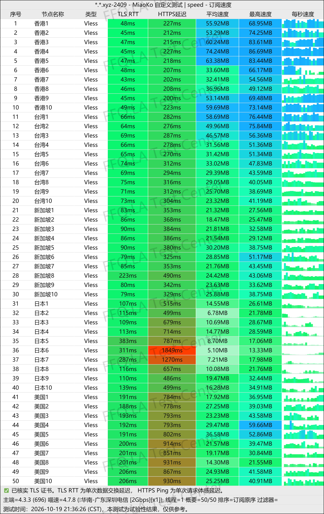
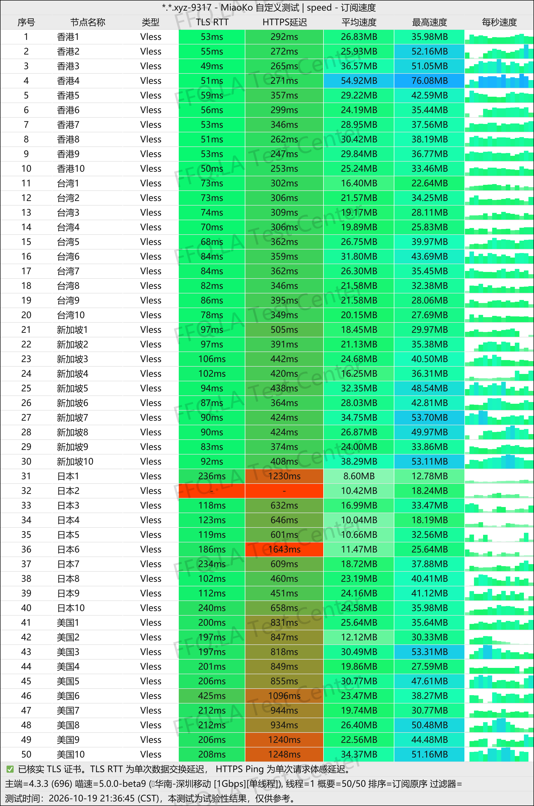
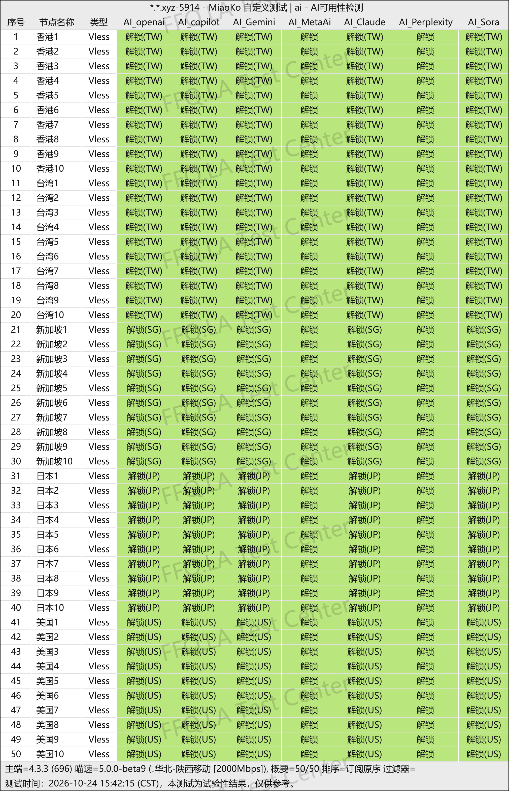
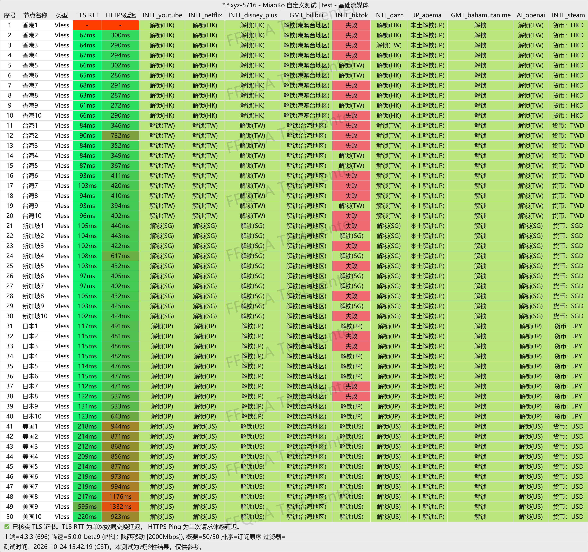
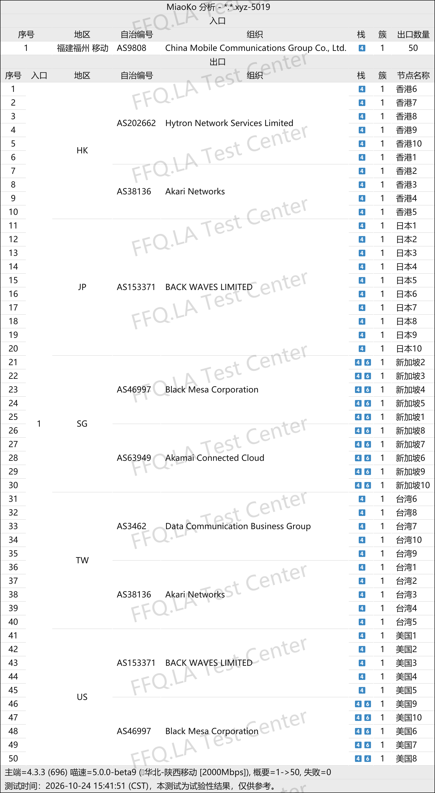

🇨🇳 [中文](README.md) | 🇺🇸 [English](README_EN.md) | 🇷🇺 Русский | 🇮🇷 [فارسی](README_FA.md)

# Официальный сайт OKyun (OK Cloud) VPN (обновлено 14 ноября 2026)

Официальный сайт VPN-сервиса OKyun (OK Cloud)<br>
`Существующие пользователи PyroCloud могут войти в свой аккаунт напрямую.`<br>

Новый адрес 01: [www.okyun1.com](https://to.iix.im/ok01)<br>
Новый адрес 02: [www.okyun2.com](https://to.iix.im/ok02)<br>
Официальный адрес: [www.ok云.com](https://to.iix.im/ok03)<br>

`Настоятельно рекомендуется использовать фирменное клиентское приложение. Официальный клиент работает через выделенные сетевые линии, тогда как подключения через ссылки подписки используют прямые маршруты. Подписки в основном подходят пользователям China Mobile и China Unicom. Пользователи China Telecom могут столкнуться со снижением скорости в вечерние часы пик, поскольку эти маршруты не имеют специальной оптимизации для сети China Telecom.`

Лучшие VPN-сервисы 2026 года: рекомендации и подборка серверов: [https://github.com/jdnei/JiChangTuiJian](https://github.com/jdnei/JiChangTuiJian)<br>

## Telegram-сообщество VPN: акции, скидки и бонусы #AD

[Группа розыгрышей VPN](https://331024.de/archives/choujiang) | [Чат VPN](https://331024.de/archives/choujiang) | [Группа тестирования VPN](https://331024.de/archives/choujiang)<br>

[https://331024.de/archives/choujiang](https://331024.de/archives/choujiang)

## Пригласительный код

```bash
JcL9ru2a
```

## Промокод / Код скидки

`Скидка 20%, действует до конца указанного дня`

```bash
20261111
```

## Описание

OKyun (OK Cloud) VPN — сервис для ускорения интернет-соединения, специализирующийся на высокоскоростных промежуточных маршрутах через публичный интернет и зарубежных транзитных соединениях.

Сервис использует протокол VLESS и предоставляет точки входа через сети трёх основных китайских операторов связи, а также промежуточные серверы за рубежом.

OKyun поддерживает Windows, macOS, Linux, Android и iOS и предлагает собственные клиентские приложения.

Сервис подходит для повседневного использования интернета, просмотра видео высокой чёткости, работы с инструментами искусственного интеллекта и международной удалённой работы.

## Преимущества

OKyun использует сетевую архитектуру, объединяющую точки входа нескольких китайских операторов с зарубежными промежуточными соединениями.

Все серверы имеют **коэффициент расхода трафика 1×**, что позволяет поддерживать баланс между скоростью подключения и эффективным использованием доступного объёма данных.

Сервис поддерживает доступ к Netflix, Disney+, ChatGPT, Claude, Gemini и другим популярным международным платформам.

Также предоставляются фирменные клиентские приложения, интеллектуальная маршрутизация трафика и возможность индивидуальной настройки прокси.

Согласно результатам сторонних тестов скорости, сервис демонстрирует относительно хорошие показатели в вечерние часы пик.

OKyun сочетает простоту использования для новичков с гибкими настройками для более опытных пользователей.

## Тарифы и цены

| Название тарифа | Объём трафика | Цена за месяц | Цена за квартал | Цена за полгода | Стоимость сброса трафика | Сетевые маршруты / Расположение серверов | Особенности / Примечания |
|---|---|---|---|---|---|---|---|
| Basic-50G | 50GB | ¥10 | ¥30 | ¥60 | ¥8 | Выделенные линии с низкой задержкой; Гонконг, Тайвань, Сингапур, Япония, США | Все серверы поддерживают доступ к ИИ-сервисам и разблокировку стриминговых платформ |
| Advance-120G | 120GB | ¥20 | ¥60 | ¥120 | ¥16 | Выделенные линии с низкой задержкой; Гонконг, Тайвань, Сингапур, Япония, США | Все серверы поддерживают доступ к ИИ-сервисам и разблокировку стриминговых платформ |
| Premium-280G | 280GB | ¥40 | ¥120 | ¥240 | ¥32 | Выделенные линии с низкой задержкой; Гонконг, Тайвань, Сингапур, Япония, США | Все серверы поддерживают доступ к ИИ-сервисам и разблокировку стриминговых платформ |
| Ultimate-800G | 800GB | ¥100 | ¥300 | ¥600 | ¥80 | Выделенные линии с низкой задержкой; Гонконг, Тайвань, Сингапур, Япония, США | Все серверы поддерживают доступ к ИИ-сервисам и разблокировку стриминговых платформ |

## 📊 Практические тесты производительности и анализ

#### 1.1 Результаты тестирования скорости China Telecom в вечерние часы пик

<br>

#### 1.2 Результаты тестирования скорости China Mobile в вечерние часы пик

<br>

#### 2.1 Отчёт о доступности ИИ-сервисов

<br>

#### 2.2 Отчёт о разблокировке стриминговых сервисов

<br>

#### 3. Анализ выходных серверов и входящих сетевых маршрутов

<br>
